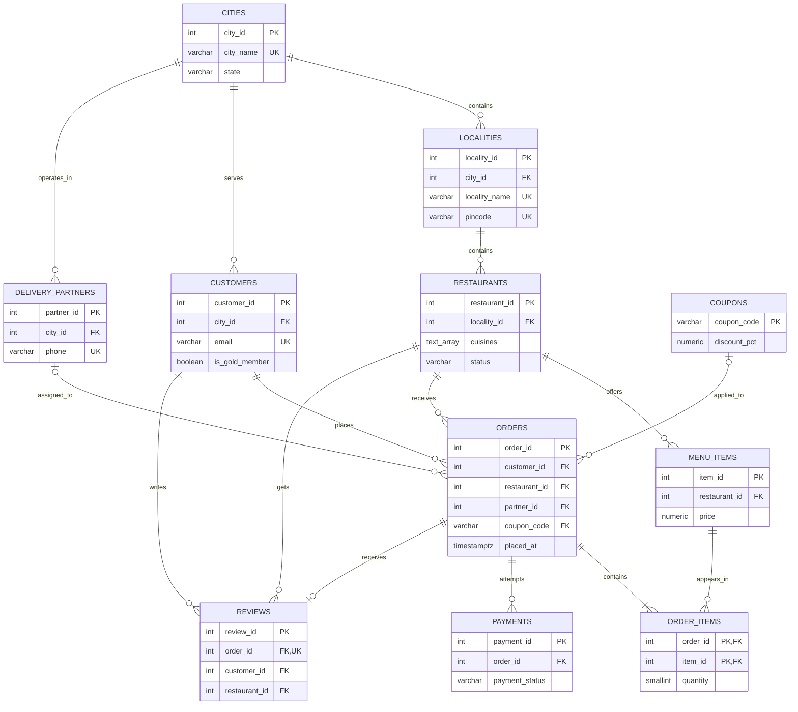

# Phase 2: Schema Design

## 1. Design summary

The database uses PostgreSQL and creates all tables in the `zomato` schema.
The design follows the CSV headers exactly so that the supplied workload can
query the tables without translation. `\copy` loads parent tables before child
tables in [`sql/02_load_data.sql`](../sql/02_load_data.sql).

The schema deliberately creates only keys and constraints. PostgreSQL creates
indexes automatically for primary-key and unique constraints; no additional
tuning indexes are present in Phase 2.

Foreign keys use PostgreSQL's default `NO ACTION` delete behavior because no
explicit `ON DELETE` action is defined. This prevents deleting a referenced
parent row while dependent data exists.

Constraint abbreviations used below:

- **PK**: primary key; **FK**: foreign key; **NN**: `NOT NULL`
- **UQ**: unique constraint; **CHK**: check constraint

## 2. Data dictionary

### `cities`

| Column | Type | Constraints | Reason |
|---|---|---|---|
| `city_id` | `integer` | PK | Stable city identifier. |
| `city_name` | `varchar(100)` | NN, UQ | City name is required and unique in the export. |
| `state` | `varchar(100)` | NN | State name is required. |

### `localities`

| Column | Type | Constraints | Reason |
|---|---|---|---|
| `locality_id` | `integer` | PK | Stable locality identifier. |
| `city_id` | `integer` | NN, FK → `cities.city_id` | Every locality belongs to a city. |
| `locality_name` | `varchar(100)` | NN, UQ | Required locality name; unique in the export. |
| `pincode` | `varchar(10)` | NN, UQ | Kept as text so postal codes are not treated as quantities. |

### `customers`

| Column | Type | Constraints | Reason |
|---|---|---|---|
| `customer_id` | `integer` | PK | Customer identifier. |
| `full_name` | `varchar(150)` | NN | Customer display name. |
| `email` | `varchar(254)` | NN, UQ | Candidate login/contact key. |
| `phone` | `varchar(20)` | NN, UQ | Contact number is not numeric data. |
| `city_id` | `integer` | NN, FK → `cities.city_id` | Customer's operating city. |
| `signup_date` | `date` | NN | Date the customer joined. |
| `is_gold_member` | `boolean` | NN, default `false` | Gold membership flag. |
| `gold_expires_on` | `date` | Nullable | Non-Gold customers have empty values in the export. |
| `is_active` | `boolean` | NN, default `true` | Account activity flag. |

### `restaurants`

| Column | Type | Constraints | Reason |
|---|---|---|---|
| `restaurant_id` | `integer` | PK | Restaurant identifier. |
| `name` | `varchar(150)` | NN, UQ | Required restaurant name; unique in the export. |
| `locality_id` | `integer` | NN, FK → `localities.locality_id` | Restaurant service location. |
| `cuisines` | `text[]` | NN | PostgreSQL array preserves the CSV's multi-valued cuisine field. |
| `avg_cost_for_two` | `numeric(10,2)` | NN, CHK `> 0` | Money value with exact decimal precision. |
| `rating` | `numeric(2,1)` | Nullable, CHK `0..5` | Aggregate rating may be empty. |
| `rating_count` | `integer` | NN, default `0`, CHK `>= 0` | Number of ratings. |
| `opens_at` | `time` | NN | Daily opening time. |
| `closes_at` | `time` | NN | Daily closing time. |
| `is_pure_veg` | `boolean` | NN, default `false` | Restaurant vegetarian policy flag. |
| `status` | `varchar(30)` | NN, CHK `OPEN`, `TEMPORARILY_CLOSED`, or `DELISTED` | Controlled restaurant status. |
| `onboarded_on` | `date` | NN | Date listed on the platform. |

### `menu_items`

| Column | Type | Constraints | Reason |
|---|---|---|---|
| `item_id` | `integer` | PK | Dish identifier. |
| `restaurant_id` | `integer` | NN, FK → `restaurants.restaurant_id` | Each dish belongs to a restaurant. |
| `item_name` | `varchar(150)` | NN | Dish name. |
| `category` | `varchar(50)` | NN, CHK known menu categories | Supports category grouping and prevents unsupported values. |
| `price` | `numeric(10,2)` | NN, CHK `> 0` | Current dish price. |
| `is_veg` | `boolean` | NN, default `false` | Dish vegetarian flag. |
| `is_bestseller` | `boolean` | NN, default `false` | Bestseller badge flag. |
| `is_available` | `boolean` | NN, default `true` | Availability for ordering/search. |

### `delivery_partners`

| Column | Type | Constraints | Reason |
|---|---|---|---|
| `partner_id` | `integer` | PK | Delivery-partner identifier. |
| `full_name` | `varchar(150)` | NN | Partner display name. |
| `phone` | `varchar(20)` | NN, UQ | Contact number and candidate natural key. |
| `city_id` | `integer` | NN, FK → `cities.city_id` | Partner's operating city. |
| `vehicle_type` | `varchar(20)` | NN, CHK `BICYCLE`, `BIKE`, `EV`, or `SCOOTER` | Controlled vehicle domain. |
| `joined_on` | `date` | NN | Date the partner joined. |
| `rating` | `numeric(2,1)` | NN, CHK `0..5` | Partner rating. |
| `status` | `varchar(20)` | NN, CHK `ACTIVE`, `INACTIVE`, or `BLOCKED` | Controlled partner status. |

### `coupons`

| Column | Type | Constraints | Reason |
|---|---|---|---|
| `coupon_code` | `varchar(50)` | PK | Coupon code is the natural identifier. |
| `discount_pct` | `numeric(5,2)` | NN, CHK `0 < value <= 100` | Percentage discount. |
| `max_discount` | `numeric(10,2)` | NN, CHK `> 0` | Maximum monetary discount. |
| `min_order_value` | `numeric(10,2)` | NN, CHK `>= 0` | Minimum qualifying order value. |
| `valid_from` | `date` | NN | Start of validity. |
| `valid_to` | `date` | NN | End of validity. |

### `orders`

| Column | Type | Constraints | Reason |
|---|---|---|---|
| `order_id` | `integer` | PK | Order identifier. |
| `customer_id` | `integer` | NN, FK → `customers.customer_id` | Customer placing the order. |
| `restaurant_id` | `integer` | NN, FK → `restaurants.restaurant_id` | Restaurant receiving the order. |
| `partner_id` | `integer` | Nullable, FK → `delivery_partners.partner_id` | Assignment may be empty for unassigned/incomplete orders. |
| `coupon_code` | `varchar(50)` | Nullable, FK → `coupons.coupon_code` | Not every order uses a coupon. |
| `placed_at` | `timestamptz` | NN | Preserves the CSV time-zone offset. |
| `accepted_at` | `timestamptz` | Nullable | Empty before restaurant acceptance. |
| `picked_up_at` | `timestamptz` | Nullable | Empty before pickup. |
| `delivered_at` | `timestamptz` | Nullable | Empty before delivery or for cancelled orders. |
| `distance_km` | `numeric(8,2)` | NN, CHK `> 0` | Delivery distance. |
| `item_total` | `numeric(12,2)` | NN, CHK `>= 0` | Sum of item charges. |
| `delivery_fee` | `numeric(10,2)` | NN, CHK `>= 0` | Delivery charge. |
| `discount` | `numeric(10,2)` | NN, default `0`, CHK `>= 0` | Applied discount. |
| `total_amount` | `numeric(12,2)` | NN, CHK `>= 0` | Stored order amount used by the workload. |
| `status` | `varchar(30)` | NN | Lifecycle status from the export. |

### `order_items`

| Column | Type | Constraints | Reason |
|---|---|---|---|
| `order_id` | `integer` | PK part, NN, FK → `orders.order_id` | Parent order. |
| `item_id` | `integer` | PK part, NN, FK → `menu_items.item_id` | Ordered dish. |
| `quantity` | `smallint` | NN, CHK `> 0` | Small whole-number quantity. |
| `unit_price` | `numeric(10,2)` | NN, CHK `> 0` | Price captured at order time. |

The composite PK `(order_id, item_id)` prevents the same dish appearing
twice as separate lines in one order while allowing a dish to appear in many
orders.

### `payments`

| Column | Type | Constraints | Reason |
|---|---|---|---|
| `payment_id` | `integer` | PK | Attempt identifier. |
| `order_id` | `integer` | NN, FK → `orders.order_id` | Order being paid for. |
| `amount` | `numeric(12,2)` | NN, CHK `> 0` | Payment amount. |
| `method` | `varchar(20)` | NN, CHK `UPI`, `CARD`, `WALLET`, or `COD` | Controlled payment method. |
| `payment_status` | `varchar(20)` | NN, CHK `FAILED`, `SUCCESS`, or `REFUNDED` | Controlled attempt result. |
| `attempted_at` | `timestamptz` | NN | Time of the payment attempt. |

`order_id` is not unique because the export explicitly allows multiple
payment attempts for one order.

### `reviews`

| Column | Type | Constraints | Reason |
|---|---|---|---|
| `review_id` | `integer` | PK | Review identifier. |
| `order_id` | `integer` | NN, UQ, FK → `orders.order_id` | The export has at most one review per order. |
| `customer_id` | `integer` | NN, FK → `customers.customer_id` | Review author. |
| `restaurant_id` | `integer` | NN, FK → `restaurants.restaurant_id` | Reviewed restaurant. |
| `food_rating` | `smallint` | NN, CHK `1..5` | Small rating value. |
| `delivery_rating` | `smallint` | Nullable, CHK `1..5` when present | Some delivery ratings are empty. |
| `review_text` | `text` | Nullable | Review text is optional in the export. |
| `created_at` | `timestamptz` | NN | Review creation time. |

## 3. Relationships and cardinalities

- One city has many localities, customers, and delivery partners.
- One locality has many restaurants.
- One restaurant has many menu items, orders, and reviews.
- One customer has many orders and reviews.
- One delivery partner can be assigned to many orders; an order has zero or
  one assigned partner.
- One coupon can be used by many orders; an order uses zero or one coupon.
- One order has many order items and payment attempts.
- One order has zero or one review.
- Orders and menu items have an M:N relationship through `order_items`.

### Mermaid ER diagram

## 4. Functional dependencies and normal form

The following determinants are candidate keys under the declared constraints:

| Table | Functional dependencies |
|---|---|
| `cities` | `city_id → city_name, state`; `city_name → city_id, state` |
| `localities` | `locality_id → city_id, locality_name, pincode`; `locality_name → locality_id, city_id, pincode`; `pincode → locality_id, city_id, locality_name` |
| `customers` | `customer_id → all other columns`; `email → customer_id`; `phone → customer_id` |
| `restaurants` | `restaurant_id → all other columns`; `name → restaurant_id` |
| `menu_items` | `item_id → all other columns` |
| `delivery_partners` | `partner_id → all other columns`; `phone → partner_id` |
| `coupons` | `coupon_code → all other columns` |
| `orders` | `order_id → all other columns` |
| `order_items` | `(order_id, item_id) → quantity, unit_price` |
| `payments` | `payment_id → all other columns` |
| `reviews` | `review_id → all other columns`; `order_id → review_id, customer_id, restaurant_id, ratings, review_text, created_at` |

Each table stores atomic attributes, so it satisfies 1NF. In the declared
design, every non-trivial determinant above is a candidate key; therefore
there are no partial dependencies or transitive dependencies between
non-key attributes, and the tables satisfy 3NF and BCNF assuming the
declared uniqueness rules reflect the business.

Some values are intentionally retained as snapshots or reporting
denormalizations:

- `orders.total_amount` can be derived from item, delivery, and discount
  values, but is retained as the recorded bill amount used by the workload.
- `order_items.unit_price` preserves the historical price even if the menu
  price later changes.
- `restaurants.rating` and `rating_count` summarize reviews and avoid
  recalculating the current restaurant score for every listing.
- `restaurants.is_pure_veg` is a restaurant policy flag, not merely a
  calculation from current menu rows.
- `reviews.customer_id` and `reviews.restaurant_id` repeat values available
  through `reviews.order_id`; they are retained because the export provides
  them directly and review queries can filter without an extra order join.

These are controlled redundancies for historical accuracy or query
performance. They should be checked for consistency during loading.

## 5. Load verification and data findings

The schema and load scripts were run against the supplied CSV files. All 11
files loaded successfully, with these counts:

| Table | Expected | Loaded |
|---|---:|---:|
| `cities` | 10 | 10 |
| `localities` | 100 | 100 |
| `customers` | 25,000 | 25,000 |
| `restaurants` | 2,500 | 2,500 |
| `menu_items` | 50,000 | 50,000 |
| `delivery_partners` | 2,000 | 2,000 |
| `coupons` | 30 | 30 |
| `orders` | 150,000 | 150,000 |
| `order_items` | 375,000 | 375,000 |
| `payments` | 137,378 | 137,378 |
| `reviews` | 39,186 | 39,186 |

Integrity checks:

| Check | Result |
|---|---:|
| Order lines whose dish belongs to a different restaurant | **0** |
| Reviews whose customer or restaurant differs from the order | **0** |
| Pure-vegetarian restaurants with a non-vegetarian dish | **0 restaurants** |
| Orders whose item-line sum differs from `item_total` | **0** |
| Delivered orders | **130,413** |
| Delivered orders with no successful payment | **1,304** |
| Delivered orders with multiple successful payments | **0** |

The 1,304 delivered orders without a successful payment are a data-quality
finding in the export, not a load failure. The schema does not add a
cross-table payment-status constraint because payment attempts are separate
rows and the supplied data must load unchanged. The issue should be reported
to the payments/data-quality team and handled explicitly by later reports.

Other verified nullable fields include unassigned delivery partners,
in-progress lifecycle timestamps, optional coupon codes, optional Gold
expiry dates, optional restaurant ratings, optional delivery ratings, and
optional review text.
